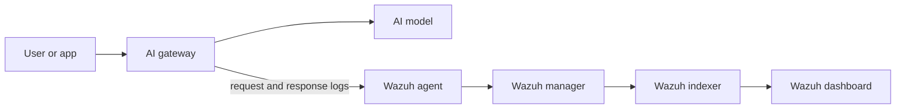

# AI Gateway SOC Lab

**Lab project.** A SOC that watches its own AI. Every AI call goes through a gateway, the gateway's logs go into Wazuh, and Wazuh rules detect AI misuse.

Built by [Kajal Dhanjal](https://linkedin.com/in/kajal-dhanjal-8a79b8311). Write-ups at [Known Good](https://knowngood.au).

## Status

Current layer: **1, SOC**. Full handover in [STATUS.md](STATUS.md).

## Architecture

Details in [docs/00-architecture.md](docs/00-architecture.md).

## Build it yourself

Follow the docs in order.

| Step | Doc | State |
|---|---|---|
| 0 | [Architecture](docs/00-architecture.md) | Draft |
| 1 | [AWS setup](docs/01-aws-setup.md) | Done |
| 2 | [Wazuh](docs/02-wazuh.md) | In progress |
| 3 | [AI model](docs/03-ai-model.md) | Not started |
| 4 | [AI gateway](docs/04-ai-gateway.md) | Not started |
| 5 | [Log pipeline](docs/05-log-pipeline.md) | Not started |
| 6 | [Detections](docs/06-detections.md) | Not started |
| 7 | [Cost and teardown](docs/07-cost-teardown.md) | Not started |

Why each choice was made: [docs/why.md](docs/why.md). Stuck? See [troubleshooting](docs/troubleshooting.md).

## Repo map

| Folder | Holds |
|---|---|
| `docs/` | Step by step guides, [why.md](docs/why.md) for the reasoning and research, `images/` for screenshots |
| `decisions/` | One page per design decision |
| `buildlog/` | Dated session notes |
| `config/` | Wazuh and gateway config |
| `detections/` | One folder per rule, with a sample event and expected alert |
| `validation/` | What each rule has actually been tested against |
| `scripts/` | Setup helpers |

## Repo rules

- No secrets: no keys, IP addresses, account IDs or unredacted screenshots.
- Lab only. Nothing here describes any employer's or client's environment.
- Validation stays honest. A rule that is written is not a rule that has fired. See [validation/STATUS-TABLE.md](validation/STATUS-TABLE.md).

## Licence

Code: [MIT](LICENSE). Docs: [CC BY 4.0](https://creativecommons.org/licenses/by/4.0/).
