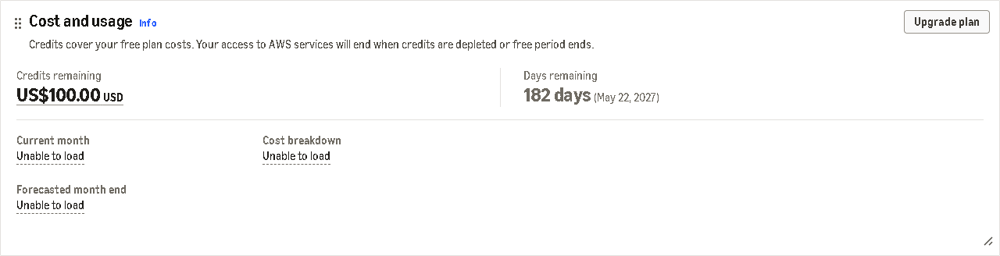
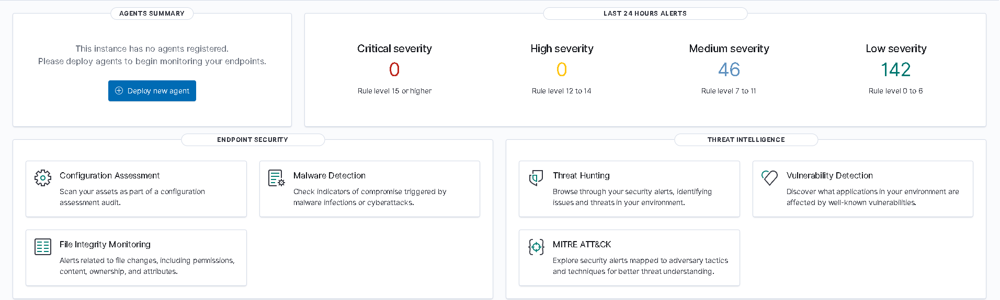
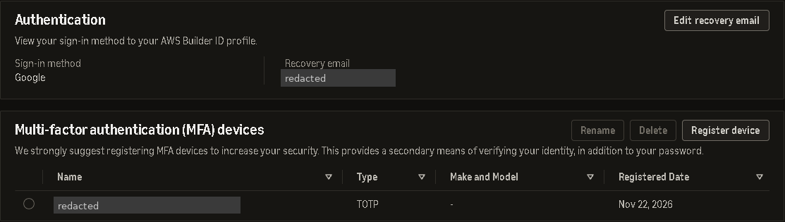
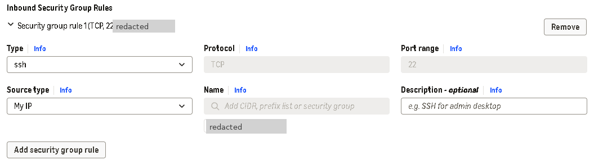
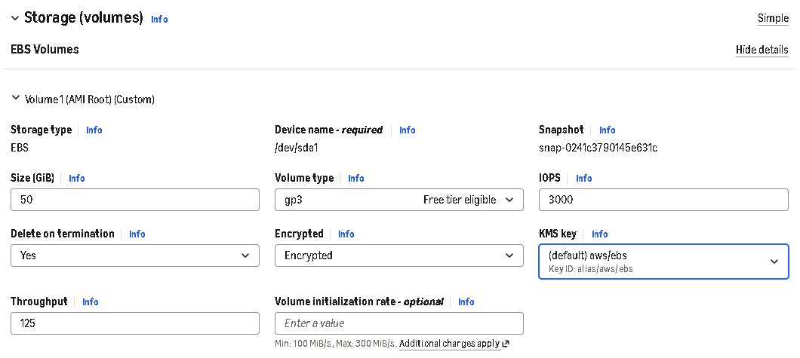

# 2026-11-22

## Goal
Secure the AWS account, launch the instance, get Wazuh running.

## Did
- Created the AWS account through the new, project based sign-up. Free plan, US$100 credit, ends 2027-05-22.

  

- Scaffolded and pushed this repo.
- Registered MFA (TOTP) on the AWS Builder ID profile.
- Confirmed home Region: Asia Pacific (Sydney).
- Launched `wazuh-lab`: m7i-flex.large, Ubuntu 26.04, 50 GiB gp3 encrypted with `aws/ebs`, security group `wazuh-lab-sg` with SSH from my IP only.
- Connected over SSH from PowerShell.
- Installed Docker Engine 29.10.0 from Docker's apt repository. `hello-world` passed. Added `ubuntu` to the `docker` group.
- Installed Wazuh 4.14.10 single node with Docker (manager, indexer, dashboard), all three containers up.
- Changed the `admin` password. `securityadmin.sh` reported cluster GREEN and all 10 config types updated. Logged in through the SSH tunnel.

  

- Wrote [docs/why.md](../docs/why.md): every choice, the alternatives, and the sources behind them.

## Broke and fixed
- Couldn't find the MFA setting in the account menu or IAM. This account type signs in through AWS Builder ID. Fixed: account menu > Profile > Security.

  

- The launch wizard defaulted SSH to Anywhere (0.0.0.0/0). Changed to My IP.

  

- The launch wizard defaulted storage to 8 GiB unencrypted. Changed to 50 GiB, encrypted.

  

- Windows SSH rejects a `.pem` with open permissions. Fixed with `icacls`, see [01-aws-setup.md](../docs/01-aws-setup.md).
- First `sed` for the password change ran with the placeholder, so the compose file said `INDEXER_PASSWORD=NEW_PASSWORD`. Caught with `grep`, fixed before `securityadmin.sh`.

## Learned
- The new sign-up gives a project with a fixed home Region and an optional spend limit, not the classic root user setup.
- Wizard defaults are not secure defaults. Check every field.
- Membership of the `docker` group is effectively root. Fine on a single-user lab box, not on a shared server.
- Wazuh 4.14 doesn't list Ubuntu 26.04 for package installs. Docker sidesteps the host OS version.
- Always `grep` a config change before restarting anything.

## Next
Change the API user (`wazuh-wui`) password, then enrol one agent.
