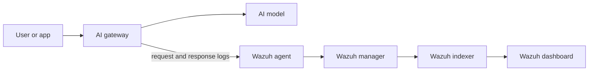

# 00 Architecture

## Goal

A SOC that watches its own AI. The gateway sits between users and the model, logs every request and response, and those logs feed Wazuh. Wazuh rules then detect AI misuse.

## Layers

| Layer | Component | Runs on | State |
|---|---|---|---|
| 1 SOC | Wazuh single node (manager, indexer, dashboard) in Docker | AWS EC2 | In progress |
| 2 AI | Model | Open question | Not started |
| 3 Gateway | AI gateway | Open question | Not started |
| 4 Pipeline | Gateway logs into Wazuh | Wazuh agent on the gateway host | Not started |
| 5 Detections | Wazuh rules for AI misuse | Wazuh manager | Not started |

## Data flow

## Access

Nothing faces the internet except SSH from one IP address. The Wazuh dashboard is reached through an SSH tunnel. See [01-aws-setup.md](01-aws-setup.md).

## Open questions

- Gateway choice.
- Model placement. The Wazuh host has no spare memory for a local model.
