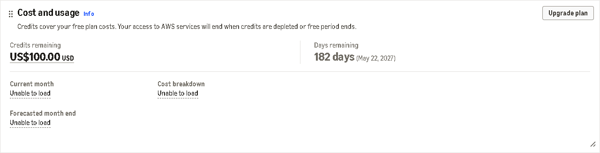
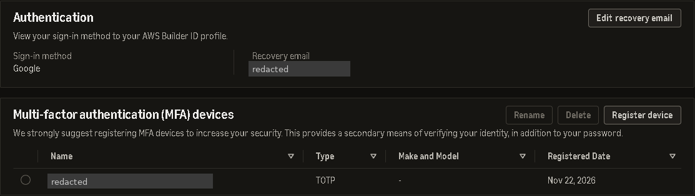
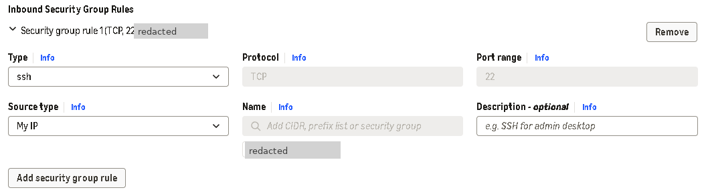
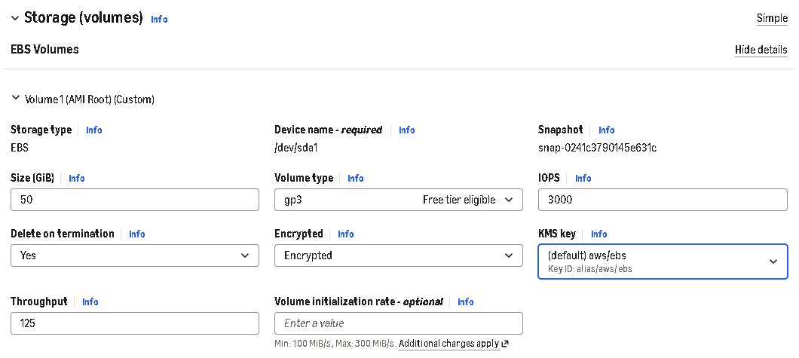

# 01 AWS setup

## Account

This lab uses an AWS account created through the new, project based sign-up, on the **Free plan**.

- New accounts get US$100 in credit at sign-up and can earn up to US$100 more.
- The Free plan does not charge you. Access ends when the credit runs out or six months pass, whichever comes first.
- Credits only apply to accounts that have never had AWS before.

Source: [AWS Free Tier FAQs](https://aws.amazon.com/free/faqs/), checked 2026-11-21.



The project based account signs in through AWS Builder ID or a social login, keeps resources in one home Region assigned at sign-up, and supports a hard spend limit per project from US$20 a month.

Source: [AWS Security Blog, secure defaults in the new AWS experience](https://aws.amazon.com/blogs/security/ease-of-use-and-secure-defaults-in-the-new-aws-experience/), checked 2026-11-22.

## 1. Secure the sign-in

Turn on MFA before launching anything.

MFA for a project based account lives on the AWS Builder ID profile, not in IAM.

1. Console, top right: project name menu > **Profile**. This opens the AWS Builder ID profile.
2. **Security** > Multi-factor authentication (MFA) devices > **Register device**.
3. Register an authenticator app (TOTP).



If you signed up with Google, GitHub or Apple, also turn on two-step verification for that account. It controls your AWS sign-in.

## 2. Check the home Region

Open EC2. The dashboard's Resources panel and Service health panel name the Region.

This lab: Asia Pacific (Sydney), `ap-southeast-2`.

## 3. Set a spend limit

Optional on the Free plan, which can't charge. Set one before upgrading to the Paid plan.

## 4. Launch the instance

EC2 > Launch instance.

| Setting | Value | Why |
|---|---|---|
| Name | `wazuh-lab` | |
| Image | Ubuntu Server 26.04 LTS, 64-bit x86 (Quick Start default) | Docker Engine supports 26.04 |
| Instance type | `m7i-flex.large` (2 vCPU, 8 GiB) | Largest Free plan type. See [decision 0001](../decisions/0001-aws-free-plan.md) |
| Key pair | New, ED25519, `.pem` | Save it. It can't be downloaded again |
| Security group | New, named `wazuh-lab-sg` | Easy to find later |
| Inbound | SSH, source type **My IP** (the wizard defaults to Anywhere, 0.0.0.0/0) | Dashboard never faces the internet |
| HTTP / HTTPS | Unticked | |
| Storage | 50 GiB gp3, Encrypted, KMS key `aws/ebs` (Configure storage > Advanced) | Wazuh's minimum disk; encrypted at rest |

Free plan instance types: [Amazon EC2 Free Tier usage](https://docs.aws.amazon.com/AWSEC2/latest/UserGuide/ec2-free-tier-usage.html), checked 2026-11-21.

Checked against a live launch on 2026-11-22.





## 5. Connect

Linux or macOS:

```bash
chmod 400 wazuh-lab.pem
ssh -i wazuh-lab.pem ubuntu@<public-ip>
```

Windows (PowerShell), lock the key to your user first or SSH refuses it:

```powershell
icacls .\wazuh-lab.pem /inheritance:r
icacls .\wazuh-lab.pem /grant:r "$($env:USERNAME):(R)"
ssh -i .\wazuh-lab.pem ubuntu@<public-ip>
```

Dashboard through a tunnel, once Wazuh is running:

```bash
ssh -i wazuh-lab.pem -L 8443:localhost:443 ubuntu@<public-ip>
```

Then open `https://localhost:8443`.

## 6. Stop when idle

A running instance burns credit. Stop it at the end of every session and record the state in [STATUS.md](../STATUS.md).
