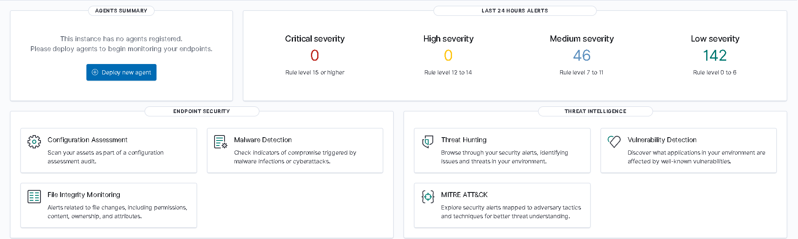

# 02 Wazuh

Single node stack in Docker, Wazuh v4.14.10.

Source for every step on this page: [Wazuh Docker deployment](https://documentation.wazuh.com/current/docker/wazuh-container.html), checked 2026-11-21.

## Host requirements

| | Wazuh minimum | This lab |
|---|---|---|
| CPU | 4 cores | 2 vCPU (below minimum, see [decision 0001](../decisions/0001-aws-free-plan.md)) |
| Memory | 8 GB | 8 GiB |
| Disk | 50 GB | 50 GiB |

## 1. Install Docker

Source: [Docker Engine on Ubuntu](https://docs.docker.com/install/linux/ubuntu/), checked 2026-11-22. Ubuntu 26.04 is supported.

```bash
# Docker's GPG key
sudo apt update
sudo apt install -y ca-certificates curl
sudo install -m 0755 -d /etc/apt/keyrings
sudo curl -fsSL https://download.docker.com/linux/ubuntu/gpg -o /etc/apt/keyrings/docker.asc
sudo chmod a+r /etc/apt/keyrings/docker.asc

# Docker's apt repository
sudo tee /etc/apt/sources.list.d/docker.sources <<EOF
Types: deb
URIs: https://download.docker.com/linux/ubuntu
Suites: $(. /etc/os-release && echo "${UBUNTU_CODENAME:-$VERSION_CODENAME}")
Components: stable
Architectures: $(dpkg --print-architecture)
Signed-By: /etc/apt/keyrings/docker.asc
EOF
sudo apt update

# Install
sudo apt install -y docker-ce docker-ce-cli containerd.io docker-buildx-plugin docker-compose-plugin

# Verify
sudo docker run hello-world
```

Optional, run Docker without `sudo` (log out and back in after):

```bash
sudo usermod -aG docker $USER
```

## 2. Kernel setting

```bash
sudo sysctl -w vm.max_map_count=262144
echo "vm.max_map_count=262144" | sudo tee /etc/sysctl.d/99-wazuh-max-map-count.conf
sudo sysctl --system
```

The first line applies it now. The other two keep it after a reboot.

## 3. Clone

```bash
git clone https://github.com/wazuh/wazuh-docker.git -b v4.14.10
cd wazuh-docker/single-node/
```

## 4. Certificates

```bash
docker compose -f generate-indexer-certs.yml run --rm generator
```

## 5. Start

```bash
docker compose up -d
```

The indexer takes about a minute. Errors about port 9200 in that minute are expected.

## 6. Log in

Through the SSH tunnel from [01-aws-setup.md](01-aws-setup.md): `https://localhost:8443`.

Default login `admin` / `SecretPassword`. It's published in Wazuh's docs, so change it straight away. Log out of the dashboard first.

## 7. Change the `admin` password

Source: [Changing the default password of Wazuh users](https://documentation.wazuh.com/current/deployment-options/docker/changing-default-password.html), checked 2026-11-22.

`admin` is both the dashboard login and the account the manager and dashboard use to reach the indexer (`INDEXER_PASSWORD`).

Avoid `$ / & # ' "` and spaces in the password. They need escaping in these files.

From `~/wazuh-docker/single-node`:

```bash
docker compose down

# Hash the new password (type it at the prompt, copy the output)
docker run --rm -ti wazuh/wazuh-indexer:4.14.10 bash /usr/share/wazuh-indexer/plugins/opensearch-security/tools/hash.sh

# Under admin:, replace the hash: value with the new hash
nano config/wazuh_indexer/internal_users.yml

# Swap the old password in the compose file. Type your real password, not a placeholder
sed -i 's/SecretPassword/<your-new-password>/g' docker-compose.yml
grep -n INDEXER_PASSWORD docker-compose.yml   # two lines, both the new password

docker compose up -d
docker exec -it single-node-wazuh.indexer-1 bash
```

Inside the indexer container:

```bash
export INSTALLATION_DIR=/usr/share/wazuh-indexer
export CONFIG_DIR=$INSTALLATION_DIR/config
CACERT=$CONFIG_DIR/certs/root-ca.pem
KEY=$CONFIG_DIR/certs/admin-key.pem
CERT=$CONFIG_DIR/certs/admin.pem
export JAVA_HOME=/usr/share/wazuh-indexer/jdk

# Wait 1 to 5 minutes after start, then:
bash /usr/share/wazuh-indexer/plugins/opensearch-security/tools/securityadmin.sh -cd $CONFIG_DIR/opensearch-security/ -nhnv -cacert $CACERT -cert $CERT -key $KEY -p 9200 -icl
exit
```

Success looks like `Clusterstate: GREEN`, a `SUCC` line for each of the 10 config types, and `Done with success`.

Never put the password in this repo.

Logged in with the new password:



## Done when

- [x] Dashboard loads with the new password
- [x] Default password changed (`admin`)
- [ ] One agent reporting
